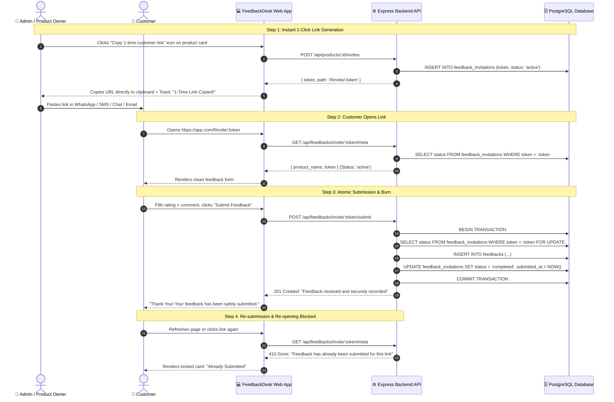

# Simplified Single-Use Customer Feedback System

## 1. Executive Summary & Design Philosophy

### 1.1 The Goal
Enable businesses to provide **each customer with their own personal feedback link** such that:
1. **One Link = One Submission:** Once a customer submits feedback, the link is burned and cannot be used again.
2. **Immutable:** Customers cannot edit or alter their feedback after submission.
3. **Zero Customer PII Required:** The admin doesn't need to ask for or input any customer phone number, email, or name to generate the link.
4. **Frictionless & Minimalist:** No stressful countdown timers, no complex tagging systems, and no bloated admin modals. Just a single click to copy a fresh one-time link.

---

## 2. The Streamlined Architecture



---

## 3. Database Schema

The schema in PostgreSQL has been simplified via migrations `011_single_use_invitations.sql` and `012_simplify_invitations.sql`:

```sql
CREATE TABLE feedback_invitations (
  id UUID PRIMARY KEY DEFAULT gen_random_uuid(),
  product_id UUID NOT NULL REFERENCES products(id) ON DELETE CASCADE,
  token TEXT NOT NULL UNIQUE,
  status VARCHAR(20) NOT NULL DEFAULT 'active'
    CHECK (status IN ('active', 'completed')),
  feedback_id UUID REFERENCES feedbacks(id) ON DELETE SET NULL,
  created_by UUID REFERENCES users(id) ON DELETE SET NULL,
  created_at TIMESTAMPTZ NOT NULL DEFAULT CURRENT_TIMESTAMP,
  submitted_at TIMESTAMPTZ
);

CREATE INDEX idx_invitations_token ON feedback_invitations(token);
CREATE INDEX idx_invitations_product ON feedback_invitations(product_id);

ALTER TABLE feedbacks ADD COLUMN IF NOT EXISTS invitation_id UUID
  REFERENCES feedback_invitations(id) ON DELETE SET NULL;
```

---

## 4. API Reference

### 4.1 Admin Endpoint (Authenticated)

#### `POST /api/products/:id/invites`
Generates a fresh single-use token in 1 click.
* **Authentication:** Required (User owns the product or has `public_link:manage` access).
* **Response (201 Created):**
  ```json
  {
    "id": "97e68e7b-1cb8-4e1b-...",
    "token": "4J9eO_rN0qfK1...",
    "path": "/f/invite/4J9eO_rN0qfK1..."
  }
  ```

---

### 4.2 Customer Endpoints (Public)

#### `GET /api/feedbacks/invite/:token/meta`
Verifies that the link exists and is still active.
* **Response (200 OK):**
  ```json
  {
    "product_name": "Royal",
    "industry": "ecommerce",
    "token": "4J9eO_rN0qfK1..."
  }
  ```
* **If Already Submitted (410 Gone):**
  ```json
  {
    "error": "Feedback has already been submitted for this link. Submissions cannot be edited or resubmitted."
  }
  ```

#### `POST /api/feedbacks/invite/:token/submit`
Submits feedback and atomically burns the token.
* **Request Body:**
  ```json
  {
    "feedback": "Great service and fast delivery!",
    "rating": 5,
    "email": null
  }
  ```
* **Response (201 Created):**
  ```json
  {
    "message": "Feedback received and securely recorded. Thank you!",
    "id": "e3b8a1c4-...",
    "status": "completed"
  }
  ```
* **Subsequent Attempts (409 Conflict):**
  ```json
  {
    "error": "Feedback has already been submitted for this link. Responses cannot be modified or resubmitted."
  }
  ```

#### `POST /api/feedbacks/scan/:id/dispense`
Counter QR Dispenser endpoint. When a customer scans a printed counter standee pointing to `/f/scan/:id`, this endpoint generates and returns a fresh, private single-use token on the fly.
* **Response (201 Created):**
  ```json
  {
    "token": "7K2vP_xM9qfZ...",
    "path": "/f/invite/7K2vP_xM9qfZ...",
    "product": {
      "id": "123e4567-...",
      "name": "Counter Cafe",
      "industry": "food"
    }
  }
  ```

---

## 5. Counter QR Code: "Print Once, Dispense Forever" Architecture

### 5.1 The Physical Counter Problem
In a physical store or restaurant, businesses want to print an acrylic standee or table tent once and leave it at the counter for months without reprinting paper.

### 5.2 The Dynamic Dispenser Solution
1. **Printed URL:** The printed counter QR encodes a permanent dispenser URL:  
   `https://app.com/f/scan/:productId`
2. **Dynamic Dispense:** When a customer scans the QR with their camera:
   - The browser opens `/f/scan/:productId`.
   - The system checks if the customer already submitted feedback for this counter in the last 24 hours (24-hour visit lock).
   - If already submitted, it displays a polite *"Feedback already received for this visit"* card.
   - If new, the backend dispenses a brand new single-use token (`/f/invite/:token`) and automatically redirects the customer.
3. **Single-Use Burn:** Once submitted, that customer's token is permanently burned in the database, and their visit is marked as completed on their phone.
4. **Next Customer:** The next customer scans the exact same printed QR standee and receives their own distinct single-use token.

---

## 6. Legality & Compliance Analysis

### 6.1 GDPR (EU & UK) & Data Privacy
* **Data Minimization (Article 5(1)(c)):** Zero customer PII is collected to generate or submit feedback. This is the gold standard of Privacy by Design.
* **No Cookie Consent Required:** No invasive tracking or third-party advertising cookies are used.
* **Write-Once Integrity:** Feedback is recorded as an immutable log event.

### 6.2 FTC (US) & EU Omnibus Directive (Verified Reviews)
* Guarantees that each feedback item represents a distinct, genuine link without bots or duplicate spam inflating scores.

---

## 7. How to Use in the Dashboard

### A. Direct 1-on-1 Outreach (WhatsApp / Email / SMS / DM)
1. Go to **Products**.
2. On any product card, click the **UserCheck icon** (`Copy 1-time customer link`).
3. The link is generated and copied to your clipboard instantly with a toast confirmation.
4. Paste it to your customer. Once submitted, it can never be used again.

### B. Physical In-Store Counter Display (Print Once)
1. On any product card, click the **QR Code icon** (`View QR Code`).
2. The modal displays your permanent **Counter QR Code** (`/f/scan/:productId`).
3. Click **"Download QR for printing"** to get the high-resolution PNG image.
4. Print it on counter stands, acrylic tents, or table stickers. Every customer scan automatically receives their own single-use link with built-in anti-spam protection!
