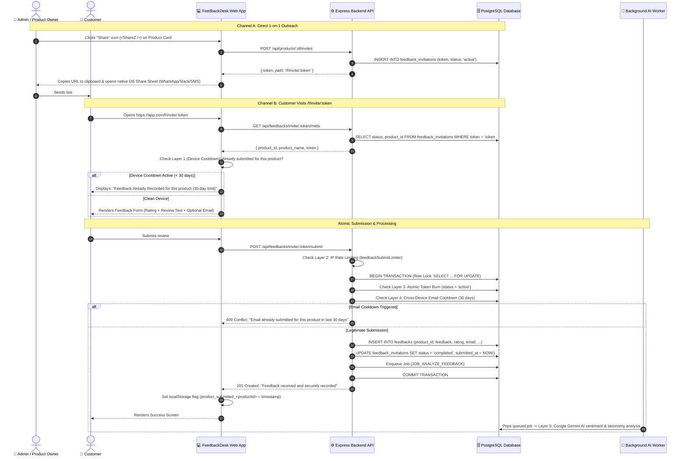

# Single-Use Customer Feedback & Anti-Spam System

## 1. Executive Summary & Design Philosophy

### 1.1 The Goal
Enable businesses to collect genuine customer feedback through two frictionless channels:
1. **Online 1-on-1 Outreach:** Instant 1-click generation from the product card that copies a unique link to the clipboard and opens the device's native share tray (WhatsApp, Slack, SMS, etc.).
2. **In-Person Physical Counters:** "Print Once, Dispense Forever" static QR standee (`/f/scan/:productId`) for cashier desks and table tents.

### 1.2 Core Invariants
* **One Token = One Submission:** Once a link is submitted, its token is permanently burned in PostgreSQL and can never be reused.
* **Write-Once Immutability:** Submissions cannot be edited or modified after completion.
* **Zero Customer PII Required Upfront:** Generating links requires no customer names, phone numbers, or emails.
* **Multi-Layer Anti-Spam Defense:** Prevents repeat submissions and review bombing even if a customer receives multiple links.
* **Minimalist & Modern UX:** No ticking 30-minute countdown timers, no intrusive hardware canvas fingerprinting, and no confusing dropdowns.

---

## 2. End-to-End System Architecture



---

## 3. How Each Feedback Is Handled & What Layers Are Applied

Every incoming review passes through a strict 5-layer pipeline before it is finalized and analyzed:

```
[Customer Request]
       │
       ▼
┌────────────────────────────────────────────────────────┐
│ Layer 1: Client-Side Device Cooldown (Browser Tier)    │
│ Checks localStorage for 30-day product lock.           │
└────────────────────────────────────────────────────────┘
       │ (Passed)
       ▼
┌────────────────────────────────────────────────────────┐
│ Layer 2: IP Sliding Window Limiter (Network Tier)      │
│ Throttles requests to max 30 per 15 min per IP.        │
└────────────────────────────────────────────────────────┘
       │ (Passed)
       ▼
┌────────────────────────────────────────────────────────┐
│ Layer 3: Atomic Token Burn (Transaction Tier)          │
│ PostgreSQL row-level lock (FOR UPDATE).                │
│ Ensures token can only ever be submitted ONCE.         │
└────────────────────────────────────────────────────────┘
       │ (Passed)
       ▼
┌────────────────────────────────────────────────────────┐
│ Layer 4: Cross-Device Email Cooldown (Identity Tier)   │
│ Checks if email already reviewed product in 30 days.   │
└────────────────────────────────────────────────────────┘
       │ (Passed)
       ▼
┌────────────────────────────────────────────────────────┐
│ Layer 5: Payload Deduplication & AI Analysis (AI Tier) │
│ Computes SHA-256 fingerprint; enqueues Google Gemini   │
│ worker for sentiment & category taxonomy tagging.      │
└────────────────────────────────────────────────────────┘
```

### Detailed Layer Breakdown:

| Layer | Where Executed | Mechanism | What It Does & Protects Against |
| :--- | :--- | :--- | :--- |
| **Layer 1: Device Cooldown** | Frontend (Browser) | `localStorage.getItem('product_submitted_<productId>')` with 30-day window | If the customer receives another link tomorrow or scans the counter QR again, their device immediately recognizes the product and shows a polite *"Feedback Already Recorded"*. Blocks 90% of repeat submissions without requiring any network call. |
| **Layer 2: Network Rate Limiter** | Express Middleware | `feedbackSubmitLimiter` (IP window: 30 requests / 15 mins) | Protects against automated bot attacks, curl loops, and DDoS floods hammering public endpoints. |
| **Layer 3: Atomic Token Burn** | PostgreSQL Transaction | `SELECT ... FOR UPDATE` + `status = 'completed'` | Prevents race conditions. If a script sends 10 concurrent requests for the same token at the exact same millisecond, row locking guarantees only 1 succeeds; the other 9 receive `409 Conflict`. |
| **Layer 4: Cross-Device Email Cooldown** | PostgreSQL Query | `SELECT id FROM feedbacks WHERE product_id = $1 AND LOWER(email) = LOWER($2) AND received_at > NOW() - INTERVAL '30 days'` | Device-independent protection. If the customer opens a fresh link in Incognito or on another computer and enters the same email address, it is rejected with `409 Conflict`. |
| **Layer 5: AI & Content Intelligence** | Node.js Worker & Gemini API | Cryptographic `submission_fingerprint` + Asynchronous LLM job queue | Strips PII via `sanitizeForAi`, verifies payload freshness, and classifies review sentiment and category asynchronously without adding latency for the user. |

---

## 4. Physical Counter QR: "Print Once, Dispense Forever"

### 4.1 The Problem It Solves
Printed ink on paper is static. If a business prints an acrylic counter stand with a static burned link, the first customer burns the standee for everyone else.

### 4.2 The Solution: Dynamic Counter Dispenser
1. **Printed URL:** The acrylic counter QR encodes the permanent dispenser link:  
   `https://app.com/f/scan/:productId`
2. **On Scan:** When Customer A scans the standee with their smartphone camera:
   - Checks if they already submitted feedback today (24-hr visit lock).
   - If clean, calls `POST /api/feedbacks/scan/:id/dispense`.
   - The backend generates a fresh single-use token on the fly and redirects them to `/f/invite/:token`.
3. **On Next Customer:** Customer B scans the exact same printed counter standee and receives their own independent token.

---

## 5. API Reference

### 5.1 Admin Endpoints (Authenticated)

#### `POST /api/products/:id/invites`
Generates a fresh 1-time single-use link for direct customer outreach.
* **Authentication:** Required (`product:read` or admin access).
* **Response (201 Created):**
  ```json
  {
    "id": "97e68e7b-1cb8-4e1b-...",
    "token": "4J9eO_rN0qfK1...",
    "path": "/f/invite/4J9eO_rN0qfK1..."
  }
  ```

---

### 5.2 Customer Public Endpoints

#### `GET /api/feedbacks/invite/:token/meta`
Validates that the token exists and is active.
* **Response (200 OK):**
  ```json
  {
    "product_id": "123e4567-e89b-...",
    "product_name": "Royal Infrastructure",
    "industry": "construction",
    "token": "4J9eO_rN0qfK1..."
  }
  ```
* **If Already Completed (410 Gone):**
  ```json
  {
    "error": "Feedback has already been submitted for this link. Submissions cannot be edited or resubmitted."
  }
  ```

#### `POST /api/feedbacks/invite/:token/submit`
Atomically records the review, burns the token, and enqueues AI processing.
* **Request Body:**
  ```json
  {
    "feedback": "Outstanding service and quick response!",
    "rating": 5,
    "email": "customer@example.com"
  }
  ```
* **Response (201 Created):**
  ```json
  {
    "message": "Feedback received and securely recorded. Thank you!",
    "id": "e3b8a1c4-...",
    "status": "completed"
  }
  ```
* **Repeat Email Rejection (409 Conflict):**
  ```json
  {
    "error": "A review from this email address has already been recorded for this product in the last 30 days."
  }
  ```

#### `POST /api/feedbacks/scan/:id/dispense`
Dispenses a fresh single-use token when a customer scans a printed counter standee.
* **Response (201 Created):**
  ```json
  {
    "token": "7K2vP_xM9qfZ...",
    "path": "/f/invite/7K2vP_xM9qfZ...",
    "product": {
      "id": "123e4567-...",
      "name": "Counter Cafe",
      "industry": "food"
    }
  }
  ```

---

## 6. Legality & Compliance

### 6.1 GDPR (EU) & Data Privacy Act (UK)
* **Data Minimization (Art. 5(1)(c)):** Zero customer PII is collected to create or distribute links.
* **Legitimate Interest (Art. 6(1)(f)):** Anti-spam and fraud prevention storage (localStorage flags, rate limits) are strictly functional under Recital 47.
* **No Cookie Consent Banners Needed:** Functional security storage is fully exempt from ePrivacy cookie consent banners.

### 6.2 FTC (US) & EU Omnibus Directive (Review Authenticity)
* Prohibits fake, duplicate, or inflated reviews.
* The 5-layer pipeline guarantees verified 1-customer-1-submission integrity.

---

## 7. How to Use in the Dashboard

### 1. Online 1-on-1 Sharing
* On any product card in `/products`, click the **Share icon** (`<Share2 />`).
* The system generates a fresh single-use link, copies it to the clipboard, and automatically opens the native mobile/macOS share tray (WhatsApp, Slack, Messages, etc.).

### 2. In-Person Counter Display
* Click the **QR Code icon** (`<QrCode />`).
* Click **"Download QR for printing"** to download the high-resolution PNG image.
* Print the QR on acrylic counter stands, table tents, or receipts. Every scan automatically receives a distinct single-use link with anti-spam protection.
